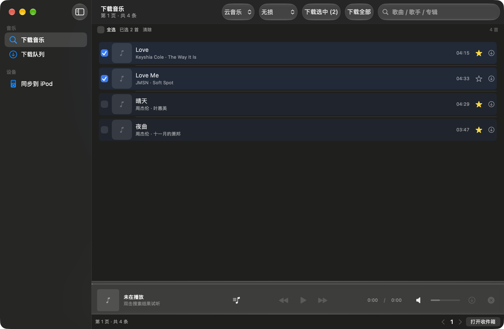
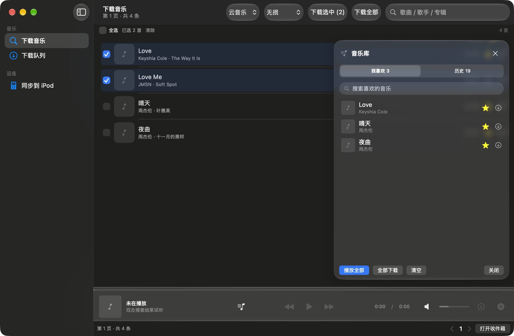
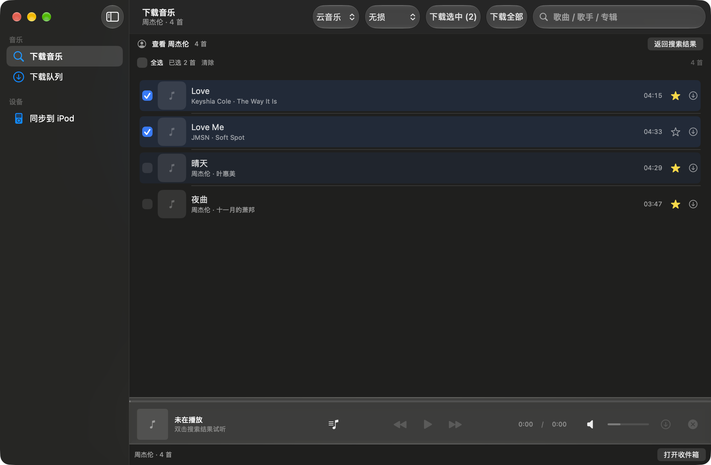
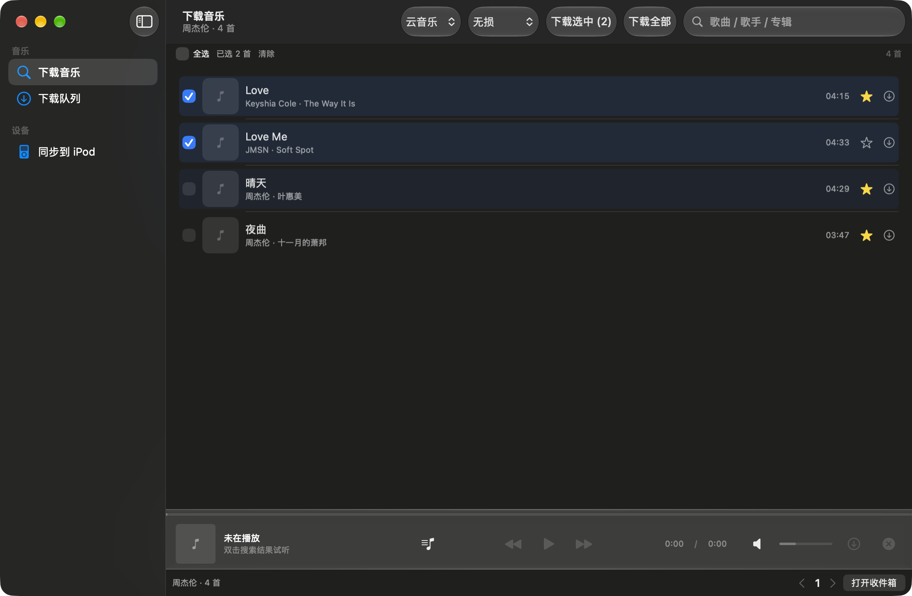

# PodSync

**把「下载音乐 → 整理 → 一键同步进 iPod」做成一个 macOS 桌面 App。**
支持原厂固件和 Rockbox / CrazyPod，一份 ALAC 曲库两边通用；内置在线搜索、试听、收藏、
同步、设备管理，并接入 macOS 系统「正在播放」。

> English: PodSync is a macOS app that downloads, tags and syncs music to classic iPods
> (stock firmware + Rockbox). It bundles its own Python/ffmpeg/libgpod runtime — no extra installs.

**本项目和 GitHub 上同名的 [owen-tariq/PodSync](https://github.com/owen-tariq/PodSync) 没有任何关系。**

---

## 功能

### 下载与试听
- 搜索云音乐 / QQ音乐 / 酷狗，按音质（无损 / 极高 320k / 标准 / Hi-Res）下载到本地收件箱
- 双击搜索结果**在线试听完整曲目**，可拖动进度、调节音量（直接联动 macOS 系统音量）
- 搜索分页（每页 50 条 + 页码跳转）
- 每行勾选框 + 全选 / 清除 / 「下载选中 (N)」批量下载
- 下载队列（未完成 / 已完成两个页签）、断点续传、失败重试、实时进度

### 整理（下载时自动完成）
- 识别真实音频格式，补写标题 / 歌手 / 专辑 / 音轨号 / 年份 / 流派
- 内嵌专辑封面，保存同步歌词 `.lrc`
- 超过 iPod 能力的音频（Hi-Res / >48kHz / >16bit / 不支持的格式）自动转成 **ALAC 16bit / 44.1kHz**
  —— 原厂固件和 Rockbox / CrazyPod 都能原生播放的最优格式

### 我喜欢的音乐
- 搜索结果、专辑、播放条、历史记录里的任意歌曲都可以点 **☆** 收藏
- 右侧 Liquid Glass「音乐库」抽屉：**我喜欢 / 历史** 两个页签
  - 支持搜索收藏、双击试听、单曲下载、播放全部、全部下载、清空
  - 点搜索页任意内容会自动收起抽屉（⌘L 或播放条按钮重新打开）
- 收藏数据本地持久化（`~/Library/Application Support/iPodSync/favorites.json`）

### 歌手 / 专辑
- 右键任意歌曲 →「**查看 歌手名**」：直接在下载页列出这位歌手的全部歌曲
  （歌手名 + 别名如 Jay Chou / 周董 深翻页 + 专辑补全，周杰伦可抓约 290+ 首，结果缓存 12 小时）
- 右键任意歌曲 →「查看整张专辑」：列出整张专辑

### 同步与设备
- 插上 iPod 即自动识别（型号 / 颜色 / 容量 / 已用空间 / 可用空间）
- 曲库表格：歌曲名 / 歌手 / 专辑 / 同步状态 / 时长 + 封面缩略图
- 勾选同步 / 全选 / 反选；按歌手、专辑筛选，按歌名 / 歌手 / 专辑搜索
- 同步：收件箱 → 转 ALAC 写入 `iPod_Control/Music/F00` → 重建 iTunesDB + ArtworkDB
  → 自动清理 CrazyPod 曲库缓存（新歌在 Rockbox 中立即可见）→ 清空收件箱
- 重复曲目提示窗口；「清理已删除歌曲」可移除失效记录 + 孤儿文件 + 重建原厂数据库
- 设备推出 / 重新挂载；可选同步完成后自动推出
- 同步歌词写入 iTunesDB（需要本项目维护的 libgpod 歌词补丁，见 `patches/`）

### macOS 系统集成
- 试听时注册为系统「正在播放」：控制中心 / 菜单栏多媒体卡片显示歌名、歌手、专辑、封面、进度
- 键盘媒体键 / 耳机线控 / AirPods 可播放、暂停、上一首、下一首、±15 秒、拖动进度
- 设置：中文 / English、外观（跟随系统 / 深色 / 浅色）、播放器封面大小、收件箱路径、
  下载渠道与音质、单份 ALAC 曲库开关、同步后自动推出

## 截图

| 下载页（勾选 + 星标 + hover） | 音乐库抽屉（我喜欢 / 历史） |
| --- | --- |
|  |  |

| 查看歌手（在下载页内展示） | 点搜索页自动收起抽屉 |
| --- | --- |
|  |  |

## 系统要求

- macOS 14.0 或更高（Liquid Glass 材质在 macOS 26+ 生效，旧系统自动回退半透明材质）
- **Apple Silicon（arm64）**，暂不提供 Intel 版本
- 一台 iPod（原厂固件 / Rockbox / CrazyPod 均可；目标卷需为 FAT32）
- 不需要安装 Python、ffmpeg、libgpod —— App 已内嵌运行时

## 安装

1. 从 [Releases](../../releases) 下载 `PodSync-macOS-arm64.zip`
2. 解压，把 `PodSync.app` 拖进「应用程序」
3. 首次打开：Finder 里**右键 → 打开 → 打开**（App 未做 Apple 公证）
   若提示「已损坏」，在终端执行：

   ```bash
   sudo xattr -dr com.apple.quarantine "/Applications/PodSync.app"
   ```

4. 首次连接 iPod 时，若系统询问「允许访问可移除宗卷」，请选择允许

## 快速上手

1. 打开 App →「下载音乐」，搜索歌名 / 歌手 / 专辑
2. 双击试听，点 ⭐ 收藏，点「下载」或勾选后「下载选中」——文件会进收件箱（默认 `~/Music/iPod-Inbox`）
3. 插上 iPod → 左侧「同步到 iPod」→ 勾选要同步的曲目 →「同步选中」（或 ⌘R 全部同步）
4. 同步完成后拔线即可；Rockbox / CrazyPod 用户直接开机就能在曲库看到新歌

## 从源码构建

需要：Xcode Command Line Tools、Homebrew、Python 3（仅构建期使用）。

```bash
git clone https://github.com/<your-name>/podsync.git
cd podsync

# 1) 构建内嵌运行时（Python + ffmpeg + libgpod/itdbwrite），产物在 runtime/
brew install pkg-config glib gdk-pixbuf gettext autoconf automake libtool ffmpeg
./scripts/build_runtime.sh

# 2) 编译 App（产物 PodSync.app）
./build_gui.sh          # 发布构建（不含调试钩子）
WITH_DEVTOOLS=1 ./build_gui.sh   # 开发构建（含截图/调试钩子，仅本机调试用）
```

`bundle id` 默认 `io.github.podsync.app`，发布自己的版本时建议覆盖：

```bash
PODSYNC_BUNDLE_ID=io.github.yourname.podsync ./build_gui.sh
```

只想用命令行工具（不构建 App）：

```bash
./bootstrap.sh                       # 安装 ffmpeg + mutagen 到 vendor/
python3 ipodtune.py --help           # 整库整理 CLI
python3 ipodsync.py sync             # 收件箱 → iPod 增量同步
```

CLI 工具的完整说明见 [docs/IPODTUNE.md](docs/IPODTUNE.md)。

## 数据与隐私

- 所有数据都在本机：配置/收藏/历史/缓存位于 `~/Library/Application Support/iPodSync`，
  收件箱默认 `~/Music/iPod-Inbox`
- **无遥测、无账号、不上传任何使用数据**
- 联网只用于：COCO 音乐站（搜索 / 下载 / 封面 / 歌词）、网易云公开接口（查歌手别名）、
  Apple 封面 CDN。站点为第三方服务，可能限流或失效
- 搜索与下载走该站点的 HTTP 接口（非加密），请注意此风险

## 已知限制

- 仅 macOS 14+ / Apple Silicon
- 音乐站点只有搜索接口，单个关键词最多约 275 条结果，因此「某歌手全部歌曲」受站点索引限制
  （周杰伦约 290 首）；不是完整唱片目录
- 音频从第三方站点下载，其可用性 / 音质 / 版权状态由站点决定
- App 未公证：首次打开需要右键打开（见安装步骤）
- 只写音乐文件和 iTunesDB，不修改 bootloader；写库前请先备份 iPod
- 「PodSync」仅为本项目名称，与同名项目无关；「iPod」是 Apple Inc. 的商标，本项目与 Apple 无隶属关系

## 免责声明

本项目仅用于**备份/整理你合法拥有的音乐**，以及学习 macOS / iPod 数据库格式。
下载内容的版权归原权利人所有，请遵守当地法律与音乐服务条款。
使用本工具修改 iPod 数据库存在风险，请自行备份设备，作者不对数据丢失负责。

## 许可证

- 项目代码：**GPL-3.0-or-later**（见 [LICENSE](LICENSE)）
  —— 因为 Python 脚本依赖 GPL-2.0-or-later 的 mutagen，且内嵌 GPLv3 构建的 FFmpeg
- 第三方组件与完整许可证文本：[THIRD_PARTY_NOTICES.md](THIRD_PARTY_NOTICES.md)、[`licenses/`](licenses/)
- 内嵌 libgpod 歌词补丁：[`patches/libgpod-0.8.3-lyrics.patch`](patches/libgpod-0.8.3-lyrics.patch)

## 反馈

遇到问题请开 issue，附上：macOS 版本、iPod 型号、App 版本（设置页可见）、复现步骤与日志。
